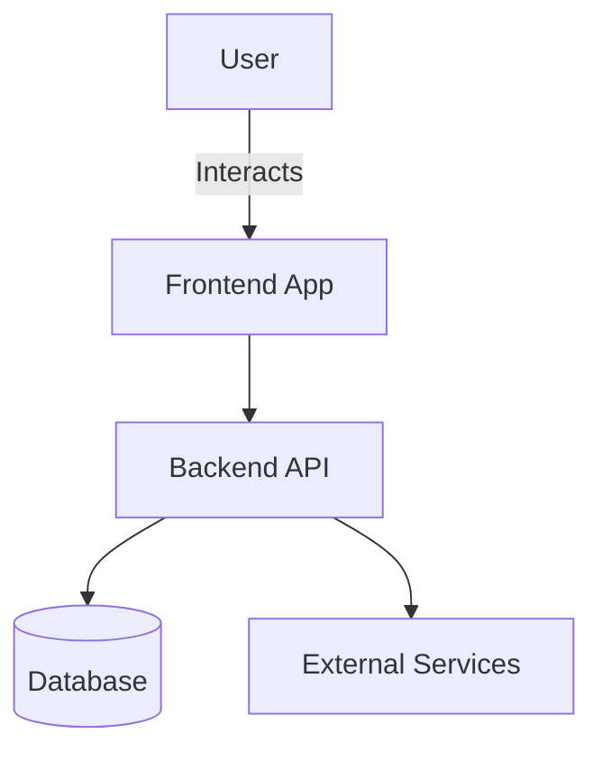

# RAG Azure Solution

## Description

RAG Azure-based solution for automated regression test management

- Components: Python
- Infrastructure: Bicep, Docker, ACR, AKS
- Main Stack: CosmoDB, Cognitive Search, Azure Container Apps, Chron Jobs

---

## Architecture

> 💡 RAG Specific Architecture.

---

## Demo / Documentation

🔗 [See full documentation](https://github.com/hmosqueraturner/smart-regression/blob/main/apps/update-rag/)

  <iframe
    src="https://hmosqueraturner.github.io/smart-regression"
    style="position:absolute; top:0; left:0; width:100%; height:100%; border:none; border-radius:12px;"
    allowfullscreen
    loading="lazy"
    onerror="this.outerHTML='

    ⚠️ Could not load the embedded demo.  GitHub may block embedded views. 
    <a href=https://github.com/hmosqueraturner/smart-regression/blob/main/apps/update-rag/README.md target=_blank>
    Open it directly here</a>.
'">
  </iframe>

---

## Tech Stack

- Main language: Python
- Infrastructure: Bicep Azure
- CI/CD: Bicep, Github Actions
- Other components: CosmoDB, Cognitive Search, Azure Container Apps, Chron Jobs

---

## Notes

> Add design decisions, related links or references here.
